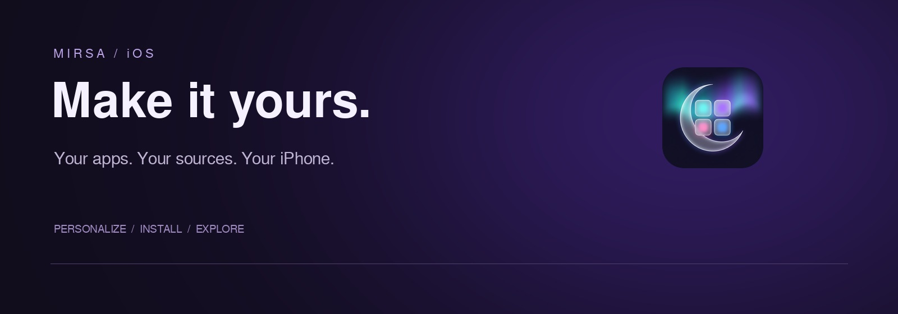
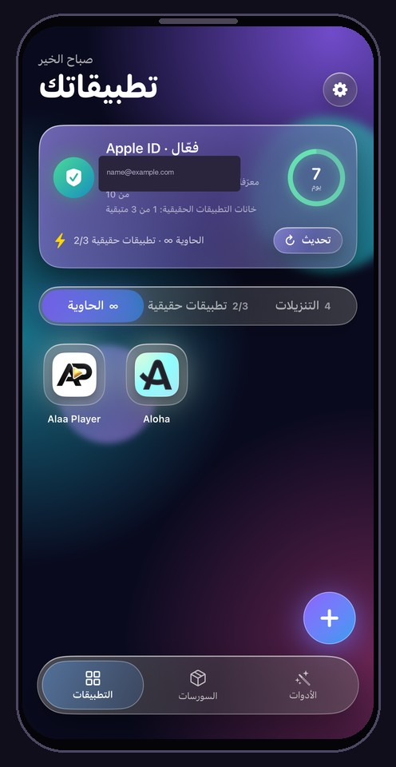
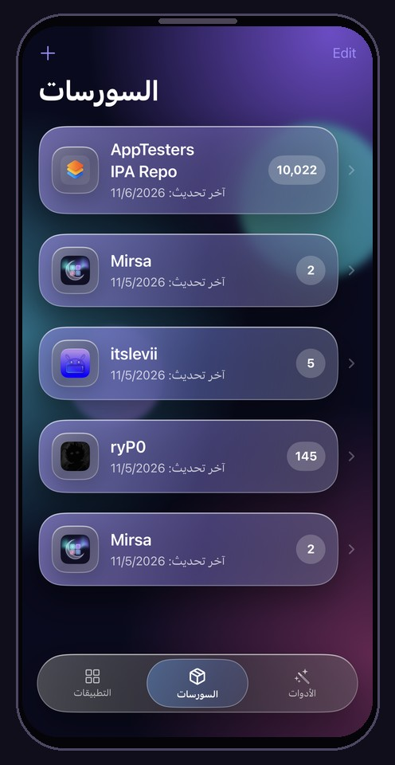
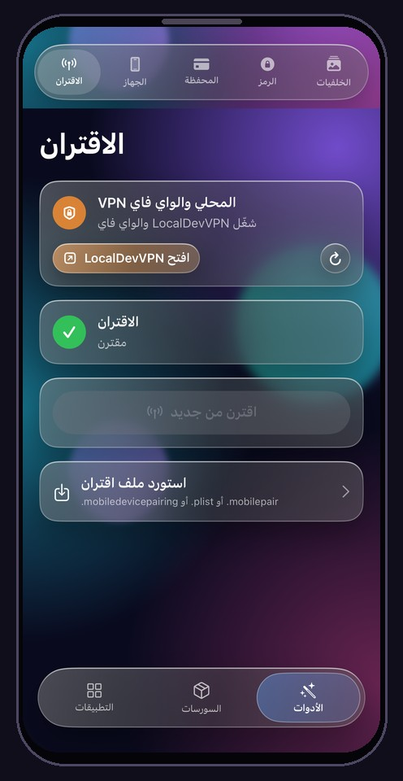
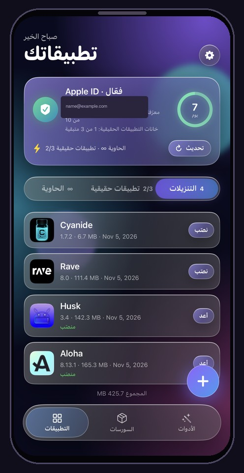

<div align="center">
  
  <h1>Mirsa · مرسى</h1>
  <p><strong>غيّر تفاصيل آيفونك، على ذوقك.</strong><br />Make your iPhone feel like yours.</p>
  <p>Wallet artwork, passcode themes and lock-screen wallpapers.<br />On your device. No jailbreak required on supported iOS versions.</p>
  <p><code>iPhone</code> &nbsp; <code>Swift + Rust</code> &nbsp; <a href="LICENSE">MIT License</a></p>
  <br />
  <p><a href="#install">Install</a> &nbsp; · &nbsp; <a href="#customize">Customize</a> &nbsp; · &nbsp; <a href="#compatibility">Compatibility</a> &nbsp; · &nbsp; <a href="#build">Build</a></p>
</div>

---

<div align="center">
  <h2>Inside Mirsa · من داخل مرسى</h2>
  <p>Real screens from the app. Personal account details are hidden.</p>
  <table>
    <tr>
      <td width="25%"></td>
      <td width="25%"></td>
      <td width="25%"></td>
      <td width="25%"></td>
    </tr>
    <tr>
      <td align="center"><strong>Home &amp; container</strong><br />الرئيسية والحاوية</td>
      <td align="center"><strong>Sources</strong><br />السورسات</td>
      <td align="center"><strong>Pairing tools</strong><br />أدوات الاقتران</td>
      <td align="center"><strong>Downloads</strong><br />التنزيلات</td>
    </tr>
  </table>
</div>

---

<h2>Mirsa 2.2</h2>

Fixed stuck chat sends so an older failed message no longer blocks new messages. Saved text and attachments are kept for retry.

صلّحت إرسال المحادثة حتى الرسالة القديمة العالقة ما توقف الرسائل الجديدة، مع الحفاظ على النص والمرفقات لإعادة المحاولة.

<a id="install"></a>
<h2>How to install / طريقة التثبيت</h2>

<strong>Install Mirsa first · ثبّت مرسى أولاً</strong>

Download **Mirsa.ipa** from the [latest release](https://github.com/Alaaaya/Mirsa-iOS/releases/latest), or use the [direct IPA download](https://github.com/Alaaaya/Mirsa-iOS/releases/latest/download/Mirsa.ipa). On your iPhone, sign and install it with a signer such as Feather or ESign using your certificate (`.p12` + `.mobileprovision`). Without a certificate, use a computer with SideStore or Sideloadly to sideload the IPA.

نزّل **Mirsa.ipa** من [آخر إصدار](https://github.com/Alaaaya/Mirsa-iOS/releases/latest)، أو من [رابط IPA المباشر](https://github.com/Alaaaya/Mirsa-iOS/releases/latest/download/Mirsa.ipa). إذا عندك شهادة (`.p12` + `.mobileprovision`)، وقّع التطبيق وثبّته مباشرة من الآيفون ببرنامج مثل Feather أو ESign. بدون شهادة، استخدم كمبيوتر مع SideStore أو Sideloadly لتثبيت ملف IPA.

<strong>Set up pairing · جهّز الاقتران</strong>

**iOS 18–26** needs a Windows PC or Mac **once**. Apple only issues pairing records to a trusted computer connected by cable. Connect your iPhone, unlock it and tap **Trust**, then export its pairing file with iLoader or jitterbugpair. Transfer the file privately to your iPhone and import it in **Mirsa > Tools > Pairing**. A friend's computer is fine; setup usually takes about five minutes. Keep the file private. It stays valid until trust is reset; an iOS update may require you to create it again.

على **iOS 18–26** بدك كمبيوتر Windows أو Mac **مرة واحدة**. Apple بتعطي ملف الاقتران بس لكمبيوتر موثوق متصل بكابل. وصّل الآيفون، افتح القفل واضغط **وثوق**، وبعدين صدّر ملف الاقتران باستخدام iLoader أو jitterbugpair. انقل الملف بشكل خاص للآيفون واستورده من **مرسى > الأدوات > الاقتران**. حتى كمبيوتر صاحبك بينفع، والخطوات عادة بتاخد حوالي خمس دقايق. خليك محتفظ بالملف بشكل خاص. بيضل صالح لحد ما تنعاد إعدادات الثقة، وتحديث iOS ممكن يحتاج تعمل ملف جديد.

On **iOS 27.0–27.2 beta 2**, Mirsa offers **on-device pairing**, with no computer needed. Open **Tools > Pairing**, choose **Pair This iPhone** and follow the prompts. Importing an existing pairing file is also supported. This on-device option does not apply to iOS 18–26.

على **iOS 27.0–27.2 beta 2** فيك تعمل **الاقتران من داخل مرسى بدون كمبيوتر**. افتح **الأدوات > الاقتران**، اختار **Pair This iPhone** واتبع التعليمات. كمان فيك تستورد ملف اقتران موجود. خيار الاقتران من الجهاز مو متاح على iOS 18–26.

<strong>Connect and install apps · اتصل وثبّت التطبيقات</strong>

Turn on **Wi-Fi** and **LocalDevVPN**, and keep the VPN connected while Mirsa uses device services. You can then add sources in Mirsa and install apps from their catalogs. Pairing does not remove the customization limits in the [compatibility table](#compatibility).

شغّل **Wi-Fi** و**LocalDevVPN**، وخلّي الـVPN متصل أثناء استخدام مرسى لخدمات الجهاز. بعدها فيك تضيف السورسات داخل مرسى وتثبّت التطبيقات منها. الاقتران ما بيلغي حدود أدوات التخصيص المذكورة في [جدول التوافق](#compatibility).

<details>
<summary><strong>Mirsa source · سورس مرسى</strong></summary>

Add this catalog URL to your installer's source settings, then select **Mirsa Setup**. The source is an app catalog, not an installation profile; the IPA still needs signing or sideloading.

أضف رابط السورس لإعدادات السورسات ببرنامج التثبيت، وبعدين اختار **Mirsa Setup**. السورس كتالوج تطبيقات، مو ملف تعريف تثبيت؛ ملف IPA بيضل بحاجة توقيع أو تثبيت من الكمبيوتر.

```text
https://github.com/Alaaaya/Mirsa/releases/download/setup/source.json
```

If release-download redirects fail, use the direct source below. Both URLs serve the same catalog.

إذا رابط التحميل ما اشتغل بسبب إعادة التوجيه، استخدم الرابط المباشر تحت. الرابطين لنفس الكتالوج.

```text
https://raw.githubusercontent.com/Alaaaya/Mirsa/main/source.json
```

</details>

## Customize

| In Mirsa | What you can change |
| :--- | :--- |
| **Wallet artwork** | Choose card backgrounds, detect your cards and apply artwork individually or in a batch. Only the appearance changes, not the card itself. |
| **Passcode themes** | Frame an image across the keypad or create separate button cutouts. Preview and reposition your design, then share it as a `.passthm` theme. |
| **Lock-screen wallpapers** | Import `.tendies` archives from Files and apply their PosterBoard assets. Respring after installation to refresh the lock screen. |

## Compatibility

Support depends on the feature, not just the iOS version. The file-transfer patch affects **customization tools only**, not app installing or the container.

الدعم بيختلف حسب الميزة. إصلاح طريقة نقل الملفات بيأثر على **أدوات التخصيص فقط**، مو على تثبيت التطبيقات أو الحاوية.

| Feature · الميزة | Compatibility · التوافق |
| :--- | :--- |
| **App installing & container**<br />**تثبيت التطبيقات والحاوية** | App installing/sideloading, sources, the container and downloads keep working on newer iOS versions with **pairing + LocalDevVPN**. The customization cutoff below does not apply to them.<br />تثبيت التطبيقات والسورسات والحاوية والتنزيلات بتضل شغالة على إصدارات iOS الأحدث مع **الاقتران + LocalDevVPN**. حدّ التخصيص المذكور بالأسفل ما بيشملها. |
| **Customization tools**<br />**أدوات التخصيص** | Wallpapers, Wallet artwork and passcode themes rely on the file-transfer method Apple patched. **iOS 18–26:** import an existing pairing record. **iOS 27.0–27.2 beta 2:** import a record, or use on-device pairing where available. **iOS 27.2 beta 3 and later: not supported for these tools.**<br />الخلفيات وتصاميم Wallet وثيمات رمز القفل بتعتمد على طريقة نقل الملفات اللي سكّرتها Apple. **iOS 18–26:** استيراد ملف اقتران موجود. **iOS 27.0–27.2 beta 2:** استيراد ملف، أو الاقتران من الجهاز إذا كان متاح. **iOS 27.2 beta 3 والأحدث: أدوات التخصيص هاي غير مدعومة.** |

Individual features may behave differently between releases. Back up your device before changing system caches.<br />
بعض الميزات ممكن تختلف بين الإصدارات. اعمل نسخة احتياطية قبل تعديل كاش النظام.

## Connect your iPhone

Mirsa needs two things before it can apply changes.

| Requirement | Purpose |
| :--- | :--- |
| **Pairing record** | Authorizes access to your iPhone's device services. Keep it private. |
| **Local loopback tunnel** | Lets Mirsa reach services on your own phone. Use LocalDevVPN or a suitable WireGuard configuration. |

<details>
<summary><strong>Import a pairing record</strong></summary>

Open **Mirsa > Tools > Pairing** and import your record from Files.

Supported formats are `.mobiledevicepairing`, `.plist` and `.mobilepair`.

If you use SideStore, look for `ALTPairingFile.mobiledevicepairing` in its Files folder. Otherwise, export a record using a pairing tool and transfer it to your iPhone.

Keep the local tunnel active while using features that require device-service access.

</details>

<details>
<summary><strong>Pair directly on a supported iPhone</strong></summary>

On compatible iOS 27 releases, choose **Pair This iPhone** in Mirsa.

Keep the displayed PIN handy, follow the Developer Mode pairing prompt in Settings, then return to Mirsa to finish.

On-device pairing is not available on every supported iOS version. Import an existing record if the option is unavailable.

</details>

## Build

Build locally on a **Mac with Xcode** and the iOS SDK required by the checked-out source.

| Tool | When you need it |
| :--- | :--- |
| **Xcode + iOS SDK** | Building the iOS app. |
| **XcodeGen** | Regenerating the Xcode project. |
| **Rust** | Rebuilding the native core. |

<details>
<summary><strong>Clone and build the unsigned IPA</strong></summary>

```sh
git clone https://github.com/Alaaaya/Mirsa-iOS.git
cd Mirsa-iOS
./build-ipa.sh
```

The unsigned IPA is placed in `build/`. Sign it using your own installation setup.

To rebuild the Rust framework first, run `./build-ios.sh` before `./build-ipa.sh`.

</details>

| Source | Location |
| :--- | :--- |
| iOS application | [`ios-app/`](ios-app/) |
| Native core | [`rust-core/`](rust-core/) |
| App build script | [`build-ipa.sh`](build-ipa.sh) |
| Native build script | [`build-ios.sh`](build-ios.sh) |

## Credits & license

Mirsa is based on [AirCard-iOS by mak5er](https://github.com/mak5er/AirCard-iOS), with contributions and research from merybist, Johnny Franks / AirLift, and the NeoSpring authors skadz108, rooootdev and neonmodder123.

Original copyright notices and component licenses remain in their respective files. Distributed under the [MIT License](LICENSE).

---

<div align="center">
  <p><strong>Mirsa · مرسى</strong></p>
  <p><a href="https://x.com/rasmtk30">Follow @rasmtk30 on X</a></p>
  <sub>Personalize your iPhone. Keep it yours.</sub>
  <br /><br />
</div>
